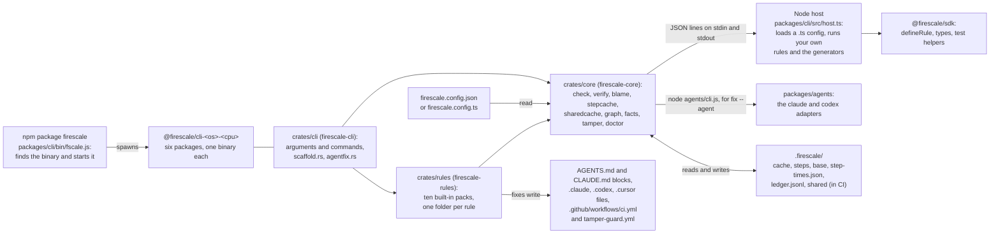
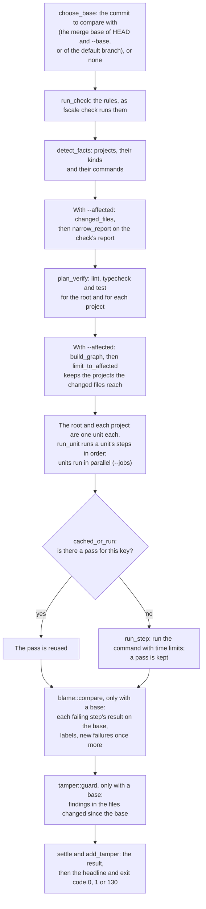
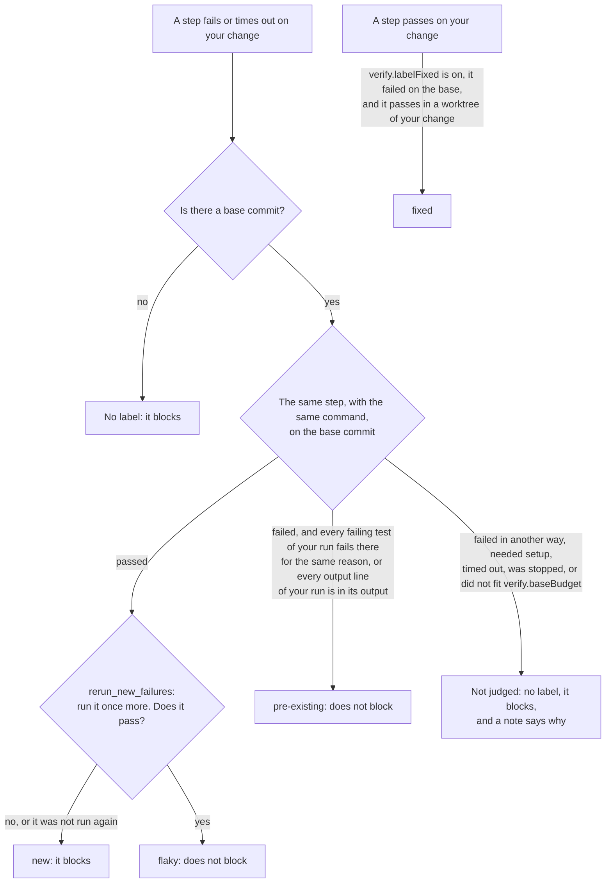
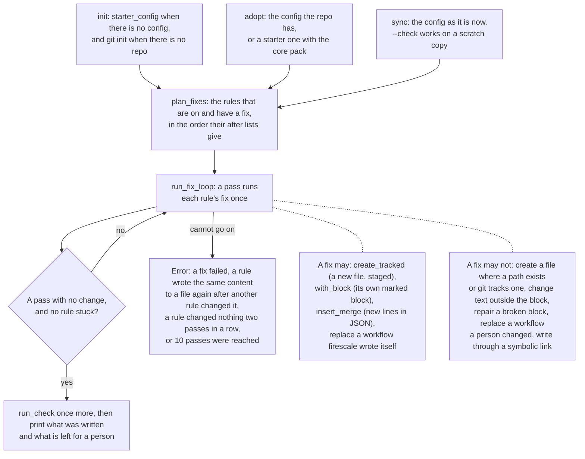
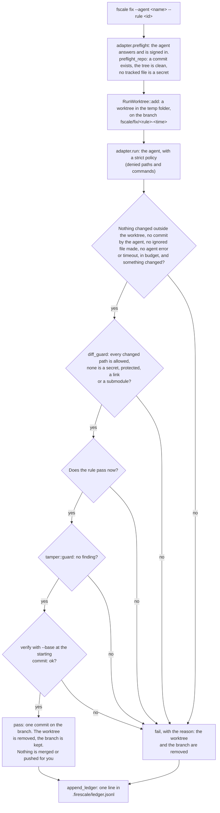
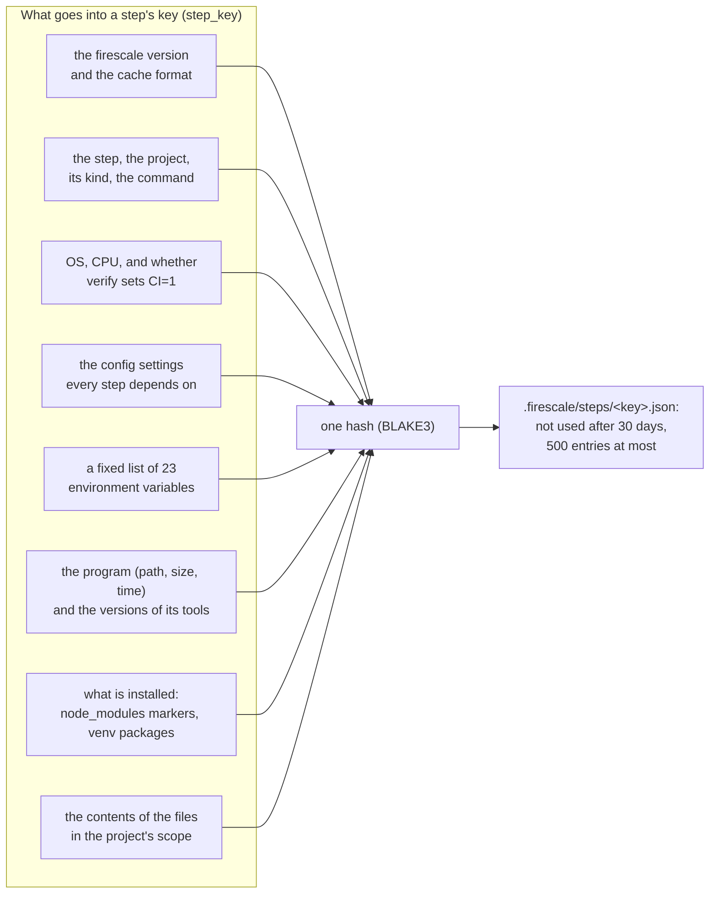
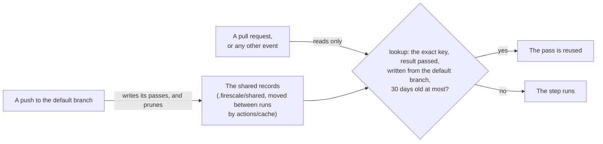
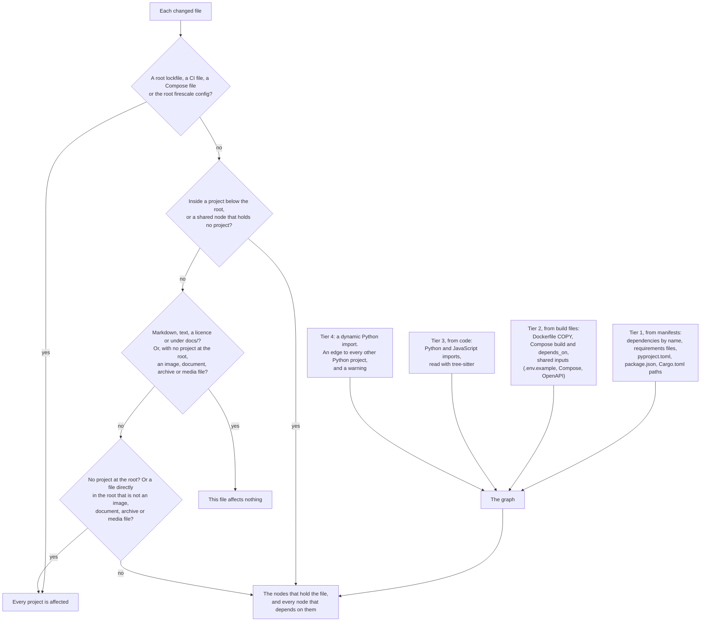

# Architecture

How firescale is put together, and why. Each section ends with the decisions (ADRs) behind it. The [README](../README.md#how-it-works) has shorter versions of the first five pictures.

Every box and arrow here names something in the code. `node scripts/check-mermaid.mjs` renders each diagram and fails when one does not parse.

## 1. The pieces

One native binary does the work. A small Node launcher starts it, and it starts Node again only for what must be TypeScript.

- **The launcher** (`packages/cli/bin/fscale.js`) maps the platform and CPU to one of six packages (`linux-x64`, `linux-arm64`, `darwin-x64`, `darwin-arm64`, `win32-x64`, `win32-arm64`), finds `bin/fscale` in it (`fscale.exe` on Windows), and starts it with the same arguments. It tells the binary where Node and the host script are (`FSCALE_NODE`, `FSCALE_NODE_HOST`) and, in an npm install, where the agent adapters are (`FSCALE_AGENTS`). Linux with musl is refused, unless `FSCALE_BINARY` names a binary you built.
- **The binary** is three crates. `crates/cli` parses arguments and holds the commands. `crates/core` is the engine. `crates/rules` holds the built-in rules: the packs `core`, `agent-ready`, `group-project`, `nextjs`, `python`, `expo`, `go`, `maven`, `cmake` and `supabase`. `crates/cli` uses both of the others, and `crates/rules` uses `crates/core`. A fourth crate, `crates/testkit`, is stand-in programs for tests and is not shipped.
- **The Node host** is started only when it is needed: for a `firescale.config.ts`, for rule packs you wrote with the SDK, and for generators (`fscale add`). `crates/core` starts it (`node.rs`), and the two talk in JSON lines.
- **The agent adapters** are one Node program (`agents/cli.js claude` or `codex`). `crates/cli` picks it (`agentfix.rs`), and `ProgramAdapter` in `crates/core` starts it.
- **What it keeps in your repo** is under `.firescale/`, which ignores itself with its own `.gitignore`. Among it: the results of `check` (`cache/`), passes of verify steps (`steps/`), results from the base commit (`base/`), how long each step took (`step-times.json`), and one line per agent run (`ledger.jsonl`).
- **What the rules write for you** is written by rule fixes (section 4). The picture names the agent files and the workflows; other fixes write other files. `init` and `adopt` also create `firescale.config.json` when there is none, and `fscale add` writes what a generator makes.

Decisions: [0008](decisions/0008-rust-front-door.md) (Rust is the front door; your own rules run through the Node host), [0013](decisions/0013-npm-packaging.md) (the npm packages), [0005](decisions/0005-config-loader.md) (the config file), [0007](decisions/0007-rule-api.md) (the API of your own rules), [0028](decisions/0028-generators.md) (generators), [0048](decisions/0048-agent-adapters-and-ledger.md) (the agent adapters).

## 2. One `fscale verify`

- **`check` comes first, and without a base a failing `check` stops everything.** With a base every step runs, so an old failure cannot hide a new one.
- **Inside one unit, without a base,** a step that fails, times out or needs setup stops the steps after it, so a failing `typecheck` stops its `test`. A failing `lint` stops nothing ([0070](decisions/0070-lint-never-hides-tests-and-a-guessed-lint-only-reports.md)). Other units always run. With a base, nothing stops a later step.
- **A lint command fscale guessed** and the repo does not declare is report-only: it is shown and never fails the run ([0070](decisions/0070-lint-never-hides-tests-and-a-guessed-lint-only-reports.md)).
- **`--budget`** leaves out steps whose kept time is longer than the budget. They are listed as not run, and the headline never says `OK`.
- **The base result of a step** comes from the cheapest of three: its key is the same on both commits, a kept result in `.firescale/base/`, or a run in a temporary git worktree of the base commit.
- **With no base** (not a git repo, no commit yet, no default branch, the default branch with no upstream, or a clean tree at the base) nothing is compared, the tamper guard does not run, and every failure blocks. The same holds for a run that was stopped.
- **The tamper guard fails the run** only when the base commit's policy is `enforced` and a finding counts.

Decisions: [0014](decisions/0014-verify-hooks-agent-ready.md) (`verify`), [0020](decisions/0020-detection-on-real-repos.md) and [0022](decisions/0022-fixes-from-0.1.1-on-a-real-repo.md) (projects, each on its own; no false `OK`), [0024](decisions/0024-verify-on-slow-real-projects.md) (time limits, parallel projects), [0032](decisions/0032-project-graph-and-affected-verify.md) (`--affected`), [0036](decisions/0036-local-step-cache.md) (the step cache), [0037](decisions/0037-blame-aware-verify-base-run.md) (the base), [0042](decisions/0042-tamper-guard.md) (the tamper guard), [0057](decisions/0057-slow-steps-and-a-budget.md) (`--budget`), [0059](decisions/0059-stopped-runs-and-doctor-env-files.md) (a stopped run), [0070](decisions/0070-lint-never-hides-tests-and-a-guessed-lint-only-reports.md) (lint).

## 3. How a failure gets its label

- **"The same way" is strict.** For pytest, Vitest, Jest and `cargo test` the failing tests are compared one by one: a test that fails on your change and not on the base makes the step `new`. A test that fails on both for a different reason, or a base run in which no test passed, leaves the step not judged. For other commands every line of the failure's output must be in the base's failure, as often.
- **Some failures are never `pre-existing`**: a step that timed out on your change and failed on the base, and a test run that stopped at its first failure.
- **The second run is one run.** It is skipped, and the failure stays `new`, when the step timed out, when the base budget is used up, or when files the step reads changed while verify ran. With per-test results a step is also `flaky` when all its new tests pass the second time and what still fails is the base's own failure.
- **The base run has its own time budget** (`verify.baseBudget`, 5 minutes unless set). A step that does not fit is not judged, and blocks.
- **A change to a lockfile or a dependency list** means the base cannot be set up the same way, so its result is "needs setup" and nothing is excused, unless `verify.baseInstall` says how to install there.
- **`fixed` is off unless you turn it on** (`verify.labelFixed`), because it runs passing steps on the base too. They run there only beside a failing step. The step must also pass in a worktree of your change, which shows that the base's failure came from the code and not from the worktree. The stop hook never labels `fixed`.
- **The `check` step is labelled by its violations**: when every violation of your change (the same rule, file and message) is on the base too, as often, it is `pre-existing`; otherwise it is `new`. It is never run a second time.

Decisions: [0037](decisions/0037-blame-aware-verify-base-run.md), [0038](decisions/0038-blame-aware-verify-per-test-labels.md), [0039](decisions/0039-blame-aware-verify-reruns-and-the-stop-hook.md), [0040](decisions/0040-base-run-fixes-after-m21.md) (lockfiles, and `fixed`), [0043](decisions/0043-fixes-after-running-0.3.0-on-the-course-project.md) (per-test results decide first), [0062](decisions/0062-quick-base-steps-first-and-the-version-note.md) (the base run goes quickest first).

## 4. The rules are the scaffold

`init`, `adopt` and `sync` have no templates of their own. Each one runs the same loop over the rules that are on.

- **One function runs all three** (`run` in `crates/cli/src/scaffold.rs`). `fscale fix` uses the same `plan_fixes` and `run_fix_loop`. The pass limit is `MAX_PASSES`, 10.
- **A managed block** is the text from a line that starts with `<!-- BEGIN firescale` to the line `<!-- END firescale -->`, in `AGENTS.md` and `CLAUDE.md`. A fix replaces only that, or adds the block at the end when there is none. Your text around it stays as you wrote it. A block with a marker missing or doubled is left for a person.
- **JSON files** (`.claude/settings.json` and the like) get lines added in place. When the file's shape does not allow it, the fix changes nothing and says what to add by hand.
- **A workflow file** is replaced only while its last line, a digest of the rest, still holds: nobody has edited it. An unchanged starter of an older version counts too.
- **`adopt --dry-run` and `sync --check`** run the whole loop on a scratch copy and print the changes as a diff. `sync --check` exits 1 when anything would change. `init` has no dry run.
- **`sync` also moves the version pin** of a stop hook firescale wrote to this version.

Decisions: [0015](decisions/0015-direction-rules-as-scaffold-and-referee.md) (the rules are the scaffold), [0018](decisions/0018-fix-loop.md) (the loop), [0019](decisions/0019-init-adopt-sync.md) (the three commands), [0027](decisions/0027-agent-files-from-init.md) (the managed block and the agent files), [0041](decisions/0041-ci-workflow-and-shared-cache.md) (the workflow and its digest), [0064](decisions/0064-the-hook-command-and-the-hook-files.md) (`sync` moves a pin).

## 5. A guarded agent run

`fscale fix --agent claude --rule <id>` lets a coding agent fix what no code fix can. The agent never works in your checkout.

- **Before the worktree is made**, the run is also refused when the repo's own agent settings let no agent edit files or deny a path with a glob that cannot work, when `core/no-secrets-in-source` has a finding, and when `.firescale/ledger.jsonl` is a symbolic link. A refusal writes no ledger line.
- **The branch name** is `fscale/fix/`, the rule id with `/` written as `-`, and the time in milliseconds.
- **Allowed paths** are the files the rule's `inputs` match and the files its findings name. Anything else in the diff fails the run.
- **After verify**, the repo outside the worktree is compared once more with how it was before the run, since the checks run code the agent wrote.
- **The reasons a run fails** are recorded as one of: `agent-error`, `timeout`, `over-budget`, `no-change`, `diff-guard`, `still-failing`, `tamper`, `verify`, `outside-worktree`, `agent-committed`.
- **The ledger** never holds the prompt, file contents or the agent's words.

Decisions: [0047](decisions/0047-guarded-agent-runner.md) (the runner and its guardrails), [0048](decisions/0048-agent-adapters-and-ledger.md) (the adapters and the ledger), [0060](decisions/0060-leftovers-after-the-audit-fixes.md) (a glob that can match no path; no ledger through a link). The tamper guard: [0042](decisions/0042-tamper-guard.md).

## 6. The step cache

A lint, typecheck or test step that passed is not run again while nothing it depends on has changed.

- **The files in a project's scope** are every file of its folder, of the projects and shared folders it depends on in the graph, the files directly in each folder above it, and every file that belongs to no project. The root's own steps cover the whole repo.
- **In GitHub Actions** the key is hashed once more with a digest of the workflow file.
- **Only a pass is kept.** A failed, timed-out, stopped, skipped or setup-needed step is never stored, so a failure always runs again. The reason is in ADR 0036: a cache that serves a stale pass is worse than no cache, so every choice leans towards running again.
- **A pass is not kept either when a file of the step changed while it ran.**
- **The version is in the key.** After an upgrade every step runs once more.
- **Some steps are never cached**: a command that reads git history (`nx affected`, `--affected`), a project with a dynamic Python import, one that may need a service the repo does not start, one whose `tsconfig` maps import paths, and a step with an input that cannot be read or a program or tool version that cannot be found.
- **Cleaning**: when there are more than 500 entries, the least recently used go first.
- `--no-cache` runs every step, and still stores the passes. `FSCALE_LOG=cache` prints why a step was or was not reused.

Decisions: [0036](decisions/0036-local-step-cache.md) (the cache and its key), [0041](decisions/0041-ci-workflow-and-shared-cache.md) (the workflow file in the key), [0043](decisions/0043-fixes-after-running-0.3.0-on-the-course-project.md) (a pass is stored as its step finishes), [0058](decisions/0058-what-a-config-change-affects.md) (the config settings in the key), [0062](decisions/0062-quick-base-steps-first-and-the-version-note.md) (a new version is named), [0064](decisions/0064-the-hook-command-and-the-hook-files.md) (the agent hook files in the key).

## 7. The shared cache in CI

With `--shared-cache <dir>` in GitHub Actions, a pass on the default branch can be reused by a pull request. The trust goes one way.

- **Only a push to the default branch writes** (`CiRun::writes`). The code checks the event and the ref; a pull request cannot add a record, whatever its workflow file says.
- **A run that only reads** looks in its own local step cache first, then in the shared records.
- **The generated workflow agrees with that**: its `pull-request` job has `cache-mode: read` and only `actions/cache/restore` steps, and the `actions/cache/save` steps are in the `default-branch` job.
- **The key in CI also holds a digest of the workflow file**, so a changed workflow starts from nothing.
- **A run that writes takes no hits from its own local cache**, so what it records was really run.
- **Outside GitHub Actions** the folder is neither read nor written.

Decisions: [0041](decisions/0041-ci-workflow-and-shared-cache.md) (the workflow and the shared cache), [0045](decisions/0045-tamper-guard-config-ci-and-the-pull-request-base.md) (the base of the `pull-request` job, and `tamper-guard.yml`), [0060](decisions/0060-leftovers-after-the-audit-fixes.md) (no record through a symbolic link).

## 8. The project graph

`fscale graph` and `verify --affected` use one graph. A node is a project (`<kind>:<folder>`) or a shared file or folder (`shared:<path>`).

- **When it is not sure, it widens.** A change it cannot place affects everything. So does history that cannot be read: no commit to compare with, or a shallow clone.
- **A project at the repo root** holds every file that no other project holds.
- **A dynamic import** also gives an edge to every shared folder with Python in it.
- **`verify --affected` treats `firescale.config.json` on its own**: it compares the settings with the base's, one by one, instead of running every project.
- **`graph --explain`** prints each edge with the file and line it came from.

Decisions: [0032](decisions/0032-project-graph-and-affected-verify.md) (the graph), [0033](decisions/0033-tree-sitter-for-imports.md) (tree-sitter), [0034](decisions/0034-files-that-affect-no-project.md) (files that affect nothing), [0043](decisions/0043-fixes-after-running-0.3.0-on-the-course-project.md) (images, documents and media), [0058](decisions/0058-what-a-config-change-affects.md) (a config change).
